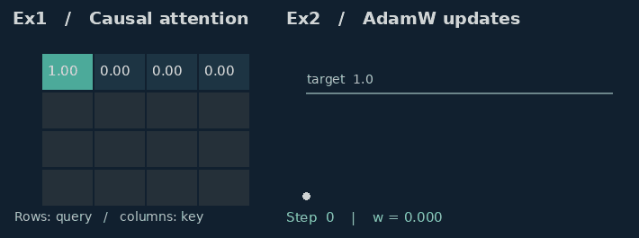
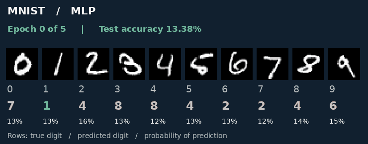
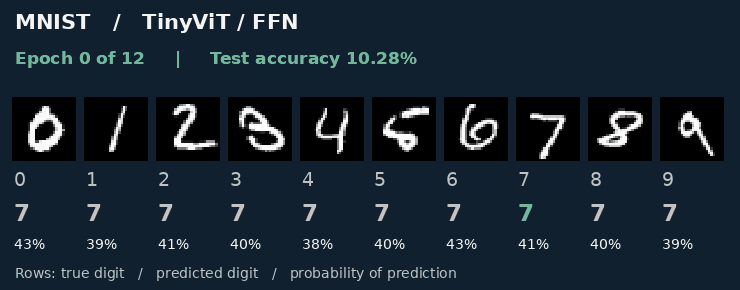

# HW1 · PyTorch로 이미지 분류기 만들기

네 노트북에서 텐서 연산과 학습 루프를 구현하고, MNIST에서 MLP와 TinyViT의 분류 정확도를 측정합니다.

<a id="ex1"></a>

## Ex1 · 텐서 연산

토큰 위치 $i,j$ 사이의 attention 점수는 query와 key의 내적 $q_i^\top k_j$입니다. `einsum_qk_scores`의 `torch.einsum("bhid,bhjd->bhij", q, k)`에서 두 입력에 공통인 특징 축 `d`가 사라지고, 결과에는 어느 query가 어느 key를 보는지 나타내는 `i, j`가 남습니다.

`make_causal_mask`는 `torch.triu(..., diagonal=1)`로 $j>i$인 칸을 표시합니다. `masked_softmax`는 이 칸의 가중치를 0으로 만들고, `einsum_apply_attention`은 나머지 가중치로 value 벡터의 가중합을 구합니다. reshape, broadcasting, gather를 포함한 텐서 연산을 서로 다른 입력 100개로 검사했고 모두 기준 연산과 일치했습니다.

<a id="ex2"></a>

## Ex2 · 미분에서 optimizer까지

길이가 다른 시퀀스를 한 배치에 넣을 때는 padding 위치를 기록합니다. 학습에서는 자동미분으로 파라미터별 gradient를 구하고, `adamw_step_`에서 gradient와 그 제곱의 이동평균을 갱신합니다.

초기값 0의 영향을 보정한 두 평균이 `m_hat`과 `v_hat`입니다. 아래 줄에서 첫 항이 gradient에 따른 보정량이고, `weight_decay * p`가 현재 파라미터 크기에 비례하는 감쇠량입니다. `alpha=-lr`이 두 항의 합에 음의 학습률을 곱해 `p`를 갱신합니다.

```python
p.add_(m_hat / (v_hat.sqrt() + eps) + weight_decay * p, alpha=-lr)
```

입력 100개로 데이터 로딩, 파라미터 초기화, 업데이트를 검사했고 모두 통과했습니다.

<details>
<summary>Ex1·Ex2 연산 예제 보기</summary>

왼쪽은 네 위치의 causal attention 가중치를 한 행씩 보여 줍니다. 미래 위치의 가중치는 0입니다. 오른쪽은 손실 $(w-1)^2$를 줄이도록 AdamW로 $w$를 20번 갱신한 결과입니다.



</details>

<a id="ex3"></a>

## Ex3 · MNIST 분류

`Linear`, normalization, dropout과 cross-entropy를 구현해 MLP를 학습했습니다. MLP가 이미지 한 장에서 내는 출력은 숫자 0~9의 점수 열 개입니다. 예측할 때는 가장 높은 점수의 숫자를 고릅니다.

정답 숫자에 배정한 확률을 $p_y$라 하면 이미지 한 장의 손실은 $-\log p_y$입니다. `cross_entropy_from_logits`는 다음 두 줄로 배치의 손실을 구합니다.

```python
log_probs = torch.log_softmax(logits, dim=-1)
return -log_probs.gather(1, targets.unsqueeze(1)).mean()
```

`gather`는 이미지마다 정답 열 하나를 꺼냅니다. 정답에 높은 확률을 줄수록 그 이미지의 손실이 작아지고, `mean()`은 배치 전체의 손실을 평균합니다.

MNIST 시험 이미지 **10,000장 중 9,694장(96.94%)**을 맞혔습니다.

<a id="demo"></a>

### 학습하면서 숫자 예측이 어떻게 달라질까

시연을 위해 노트북의 MLP를 시드 0으로 다시 학습했습니다. MNIST 시험 세트에서 숫자별로 처음 등장하는 한 장씩을 골라, 매 epoch 같은 열에 놓았습니다. 이미지 아래에는 정답, 모델의 예측, 해당 예측의 확률이 차례로 나옵니다. 상단의 정확도는 시험 이미지 10,000장 전체에서 측정한 값입니다.



두 분류 GIF에는 Yann LeCun과 Corinna Cortes의 MNIST 손글씨를 확대해 모델의 예측값을 덧붙였습니다. 두 GIF의 이용 조건은 [CC BY-SA 3.0](https://creativecommons.org/licenses/by-sa/3.0/)입니다. [MNIST 데이터와 저작권 표기](https://keras.io/api/datasets/mnist/)

<a id="ex4"></a>

## Ex4 · TinyViT

`TinyViT.forward`는 이미지를 패치로 나누고 위치 임베딩을 더합니다. 각 블록의 self-attention은 패치 사이의 정보를 섞습니다. 세 모델은 그다음에 각 패치의 특징을 변환하는 층을 각각 FFN, GEGLU, SwiGLU로 구성했습니다.

FFN은 첫 선형층의 출력에 GELU를 적용합니다. 두 게이트 방식은 `GLUFeedForward.forward`에서 `self.input_projection(x).chunk(2, dim=-1)`로 출력을 `gate`와 `value`로 나눕니다. GEGLU는 `F.gelu(gate)`, SwiGLU는 `F.silu(gate)`를 `value`에 원소별로 곱합니다. 마지막에는 `self.norm(x).mean(dim=1)`로 패치 축을 평균하고 분류기가 숫자별 점수 열 개를 냅니다.

같은 48,000장으로 12 epoch씩 학습하고 검증용 5,000장의 정확도로 checkpoint를 골랐습니다. 학습 시드는 0·1·2, 시험 이미지는 매번 같은 10,000장입니다.

| 블록 | 세 시드의 시험 정확도 |
|---|---|
| FFN | 97.69%, 97.63%, 97.79% |
| GEGLU | 98.16%, 97.95%, 97.85% |
| SwiGLU | 98.32%, 98.14%, 97.75% |

<details>
<summary>TinyViT의 epoch별 예측 보기</summary>

FFN을 쓰는 TinyViT를 시드 0으로 12 epoch 다시 학습했습니다. MLP와 같은 손글씨를 보여 줍니다. 위 표는 기존 실험에서 검증 정확도로 고른 모델의 시험 결과입니다.



</details>

## 실행

`R`을 설정한 터미널에서 실행하세요. Ex1과 Ex2는 각각 입력 100개를 모두 통과해야 합니다. 입력별 결과는 `functional-check/ex1.json`과 `functional-check/ex2.json`에 저장됩니다. 분류 노트북은 실행용 사본의 `hw1_pytorch_tutorial/src/`에서 열 수 있습니다.

```bash
cd "$R"
python -m pytest -q tests/test_hw1.py
mkdir functional-check && cd functional-check
python "$R/experiments/hw1/evaluate_functions.py"
```

[공식 과제](../../original/hw1/) · [실행 환경](../../#풀이-실행하기) · [풀이 노트북](src/hw1_pytorch_tutorial/src/) · [실험 결과](results/)
