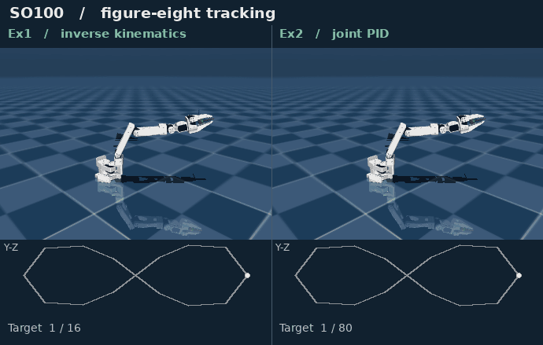

# HW2 · SO100 로봇팔의 위치 제어

SO100 로봇팔이 주어진 경로를 따라가도록 역기구학과 PID 제어기를 구현했습니다. PPO 실험에서는 관절 상태와 목표 위치를 보고 행동을 고르는 policy를 학습했습니다.

<a id="ex1"></a>

## Ex1 · 역기구학

8자 경로의 목표점은 손끝의 좌표로 주어지지만, 로봇에 필요한 값은 관절 자세 $q$입니다. L02의 선형 근사 $\Delta x \approx J(q)\Delta q$는 지금 자세에서 관절을 조금 움직였을 때 손끝이 어디로 갈지 예측합니다.

`build_keypoints`는 $x$를 고정하고 $y,z$ 평면에 8자 경로의 목표점을 배치합니다. `ik_track`은 각 목표점에서 현재 손끝 위치를 뺀 벡터를 `error`에 담고, MuJoCo의 `mj_jacSite`로 손끝 위치의 Jacobian $J$를 구합니다.

$$
(JJ^\top + \lambda I)u = k\,\mathrm{error}, \qquad \mathrm{delta} = J^\top u
$$

`ik_track`에서 위 식의 $J$, $\lambda$, $k$는 각각 `jacobian`, `damping`, `pos_gain`입니다.

```python
system = jacobian @ jacobian.T + damping * np.eye(3)
delta = jacobian.T @ np.linalg.solve(system, pos_gain * error)
data.qpos[:] += dt * delta.clip(-2.0, 2.0)
```

`system`은 손끝의 세 위치 축에 대한 $3\times3$ 행렬입니다. `solve`로 구한 $u$에 $J^\top$를 곱하면 관절별 보정량이 나옵니다. 감쇠항은 특이 자세 근처에서 보정량이 커지는 것을 줄입니다. 관절 자세를 갱신한 뒤에는 각 관절의 가동 범위를 적용하고 손끝 오차를 다시 계산합니다.

폭 0.14~0.25m인 궤적 100개를 시험했습니다. 모든 궤적에서 관절 한계를 지켰고, 궤적마다 목표점 16곳의 위치 오차가 모두 5mm 미만이었습니다.

<a id="ex2"></a>

## Ex2 · PID 추종

두 경유점 사이에서 출발하고 멈출 때 속도가 갑자기 변하지 않도록, `generate_quintic_spline_waypoints`는 진행률 $s$에 $h(s)=10s^3-15s^4+6s^5$를 적용합니다.

```python
s = np.linspace(0.0, 1.0, num_points)
time_scale = 10.0 * s**3 - 15.0 * s**4 + 6.0 * s**5
return start + np.expand_dims(time_scale, axis=-1) * (end - start)
```

`time_scale`의 각 값은 해당 시점까지 두 점 사이를 얼마나 이동할지 정합니다. $h$의 1차·2차 미분이 양 끝에서 0이므로 $s$가 시간에 비례해 늘어나면 시작점과 끝점에서 목표 속도와 가속도가 모두 0입니다.

`track`은 보간한 각 점을 Ex1의 IK로 풀어 목표 관절값을 미리 구합니다. 제어 중에는 목표 관절값에서 측정값 `data.qpos`를 뺀 오차를 최근 10개까지 보관합니다.

`pid_control`에서 P항은 마지막 관절 오차 `errors[-1]`, I항은 `errors.sum(axis=0) * timestep`, D항은 직전 두 오차의 차이를 `timestep`으로 나눈 값입니다. 첫 스텝에서는 이전 오차가 없어 D항을 0으로 둡니다. 반환값 `Kp * proportional + Ki * integral + Kd * derivative`가 관절별 토크입니다. 기본값 `Ki=0.0`에서는 P항과 D항이 토크를 결정합니다.

Ex1과 같은 폭 범위로 궤적 100개를 만들고 궤적마다 경유점 80개를 두었습니다. 로봇팔은 모든 경유점에 3cm 이내로 접근했습니다.

<details>
<summary>역기구학과 PID의 8자 경로 비교</summary>

왼쪽은 역기구학으로 구한 관절 자세를 16개 목표점에 적용한 모습입니다. 오른쪽은 PID로 경유점 80개를 추종합니다. 아래 그래프는 손끝을 정면에서 본 $y,z$ 좌표입니다. 회색 선은 목표 경로, 초록 선은 손끝이 지난 경로입니다. 두 패널은 경로의 진행률에 맞춰 재생됩니다.



</details>

<a id="ex3"></a>

## Ex3 · PPO로 목표 위치 제어

L02의 Markov decision process(MDP)에서 policy의 행동은 다음 상태와 reward에 영향을 줍니다. 이 과제에서는 MuJoCo가 로봇의 상태를 갱신하고, policy는 그중 아래 관측 벡터를 입력으로 받습니다.

### 관측

`get_obs`는 관절값에 베이스 좌표계에서 본 손끝 위치·자세와 목표 위치를 붙입니다. 예를 들어 손끝의 월드 좌표에서 베이스 위치를 빼고 베이스 회전행렬의 전치를 곱하면, 로봇을 기준으로 한 손끝 위치가 됩니다.

### 행동과 전이

Stable-Baselines3의 PPO(Proximal Policy Optimization)가 출력한 행동을 `process_action`이 `[-1, 1]` 범위로 제한합니다. 이어서 `low + 0.5 * (action + 1.0) * (high - low)`로 관절별 목표값을 구합니다. 행동이 $-1, 0, 1$이면 목표값은 각각 그 관절의 하한, 중간값, 상한입니다. `SO100TrackEnv.step`이 이 목표값을 MuJoCo에 전달하고 다음 관측을 읽습니다.

### Reward

손끝과 목표 사이의 거리가 $d$미터일 때 reward는 $e^{-2d}+\mathbf{1}_{d<0.005}$입니다. `compute_reward`에서 `np.exp(-2.0 * ee_tracking_error)`는 가까워질수록 커지는 보상입니다. 여기에 손끝이 목표의 5mm 안에 들어오면 `1.0`을 더합니다.

평가에서는 시드 107200~107299의 각 장면에서 policy가 예측한 평균 행동을 실행했습니다. **2초가 끝났을 때** 팔 끝과 목표 사이의 거리가 5cm 미만인 장면은 **100개 중 99개**였습니다.

<a id="demo"></a>

### PPO 학습 단계별 목표 추종

시드 107200에서 같은 시작 자세와 목표를 주고 2초간 실행했습니다. 왼쪽은 역기구학으로 초기화한 직후, 가운데는 평가에 선택한 6,144스텝 모델, 오른쪽은 학습을 마친 16,384스텝 모델입니다. 이 장면의 최종 오차는 각각 1.08cm, 0.98cm, 1.31cm였습니다. 노란 원이 목표 위치입니다.


## 실행

```bash
cd "$R"
python -m pytest -q tests/test_hw2.py tests/test_hw2_integration.py
mkdir hw2-check && cd hw2-check
for n in 1 2 3; do
    python "$R/experiments/hw2/evaluate.py" "$n" --max-width .25
done
```

출력의 세 숫자는 문제 번호, 성공 횟수, 총 시도 횟수입니다. 각 문제의 결과는 `1 100 100`, `2 100 100`, `3 99 100`입니다.

[공식 과제](../../original/hw2/) · [실행 환경](../../#풀이-실행하기) · [실험 결과](results/)
