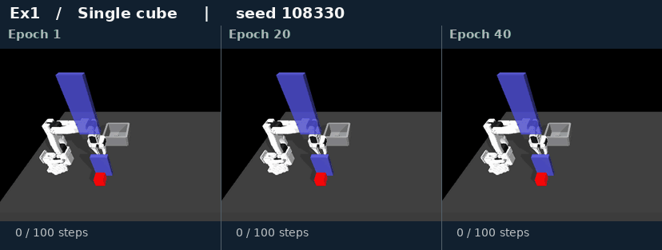
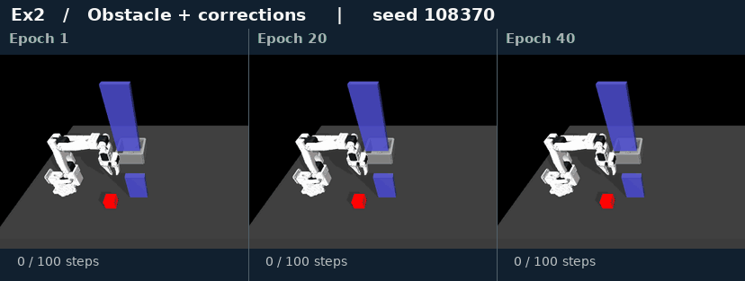
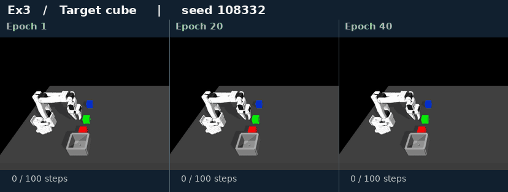
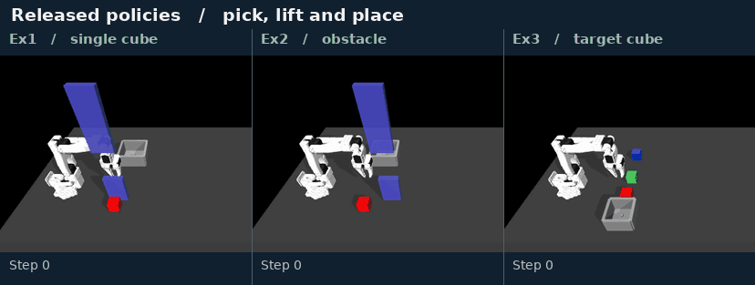

# HW3 · 시연으로 큐브 집어 옮기기

로봇은 팔 끝, 그리퍼, 큐브와 목표의 상태를 보고 팔을 어디로 움직일지, 그리퍼를 여닫을지 정합니다. 기본 모델은 시연에서 행동 묶음을 학습합니다. 공식 채점에는 접근·집기·놓기 등 시연 단계별로 다음 행동을 학습한 policy를 사용했습니다.

[L03 · Imitation Learning](https://www.youtube.com/watch?v=Ef4R5s1LqoQ) · [L07 · Action chunking](https://www.youtube.com/watch?v=imSTfMJjp7M) · [공식 원본](../../original/hw3/) · [기본 모델 구현](src/hw3_imitation_learning/hw3/model.py) · [실행 환경 준비](../../)

<a id="demo"></a>

## 학습 단계별 큐브 조작

기본 모델을 기존 시연 데이터로 문제마다 40 epoch씩 다시 학습했습니다. 아래 GIF에서는 1·20·40 epoch의 모델에 같은 시작 장면을 주고 처음 100스텝을 재생합니다. Ex2의 학습 데이터에는 장애물 앞에서 행동을 교정한 시연도 들어 있습니다.

<details>
<summary>Ex1 · 단일 큐브 (시드 108330)</summary>



</details>

**Ex2 · 장애물 (시드 108370)**

이 장면에서 20 epoch 모델은 100스텝 안에 큐브를 상자에 넣었고, 1·40 epoch 모델은 넣지 못했습니다.



<details>
<summary>Ex3 · 지정한 큐브 (시드 108332)</summary>



</details>

<a id="ex1"></a>

## Ex1 · 단일 큐브 놓기

L03의 Behavioral Cloning(BC)은 관측 $o_t$에서 시연자가 선택한 행동을 예측하는 지도학습입니다. 기본 모델은 L07에서 다룬 *action chunking*을 적용해 한 관측에서 연속된 $H$개의 행동을 예측합니다.

학습 데이터 한 건은 같은 에피소드의 `states[t]`와 `actions[t:t+H]`입니다. `ObstaclePolicy.forward`는 MLP 출력을 `(배치 크기, H, 행동 차원)`으로 바꾸고, `compute_loss`는 예측과 시연 행동의 성분별 제곱 오차를 평균합니다.

[ETH 과제의 데이터 샘플](https://github.com/mees-robot-learning-course/ethz-course-2026/blob/2e089e97d84968182c1ffa2e1bc8177530feb6fe/hw3_imitation_learning/hw3/dataset.py#L198-L210) · [기본 모델의 예측과 손실](src/hw3_imitation_learning/hw3/model.py#L19-L35)

공식 채점에서 실행하는 `single_cube.py`는 한 번에 행동 하나를 반환합니다. `_action`은 장애물 위치와 조작 단계에 해당하는 가중치로 손끝의 목표 위치를 구합니다. 현재 손끝과 목표의 차이를 세 축의 이동 명령으로 바꾸고, 여기에 그리퍼 명령 하나를 붙입니다.

다음 호출에서 관측을 다시 읽기 때문에 큐브가 들리지 않았을 때 집기 단계로 돌아갈 수 있습니다.

[목표 위치와 행동 계산](src/experiments/hw3/single_cube.py#L26-L59) · [채점기가 읽는 모델과 가중치](src/experiments/hw3/evaluate.py#L18-L22) · [독립 평가](results/ex1/)

<a id="ex2"></a>

## Ex2 · DAgger와 장애물

BC로 배운 policy가 큐브를 비껴 잡으면 이어지는 관측도 시연과 달라집니다. DAgger(Dataset Aggregation)는 이렇게 학습 중인 policy가 도달한 상태에서 전문가의 행동을 받아 학습 데이터에 추가합니다.

여기서 전문가 역할은 스크립트가 맡습니다. `--dagger-checkpoint`를 주면 `learner_prefix`가 먼저 기존 policy로 3~51스텝 움직입니다. 이어서 `demonstrate`가 그 상태에서 복구 동작을 실행합니다.

학습용으로 기록하는 쌍은 **교정 명령을 보내기 직전의 관측과 그 명령**입니다. 수집기는 성공하고 그리퍼가 큐브에서 떨어진 에피소드를 저장합니다. 기본 모델 학습 시 `--extra-zarr`로 이 데이터를 넘기면 `load_and_merge_zarrs`가 기존 시연과 합칩니다.

[policy 실행과 교정 시연 수집](src/hw3_imitation_learning/scripts/collect_scripted_demos.py#L140-L167) · [관측과 교정 행동을 짝짓는 순서](src/hw3_imitation_learning/scripts/collect_scripted_demos.py#L69-L91) · [데이터를 합치는 학습 코드](src/hw3_imitation_learning/scripts/train.py#L81-L85)

채점용 policy는 시작할 때 장애물의 가로 위치로 구역을 고르고, 해당 구역과 현재 조작 단계에 맞는 행동을 냅니다.

별도 놓기 평가에서 장애물이 왼쪽에 있을 때는 40/40회, 중앙은 12/14회, 오른쪽은 46/46회 성공했습니다.

[장애물 대응 policy](src/experiments/hw3/single_cube.py) · [시연 수집 코드](src/hw3_imitation_learning/scripts/collect_scripted_demos.py) · [장애물 위치별 결과](results/ex2/independent-zones.json)

<a id="ex3"></a>

## Ex3 · 여러 큐브 중 지정한 큐브 놓기

장면에 큐브가 세 개 있으면 로봇과 큐브의 위치가 같아도 지시한 색에 따라 손을 뻗을 위치가 달라집니다. L03의 목표 조건부 policy $\pi(a\mid o,g)$에서 이 과제의 $g$는 **집어야 할 큐브의 색**입니다. 큐브를 내려놓을 상자의 위치는 별도 입력입니다.

`MultiTaskPolicy.sample_actions`는 19차원 관측을 손끝(3), 그리퍼(1), 세 큐브의 좌표(9), 색을 지정하는 one-hot 벡터(3), 상자 위치(3)로 나눕니다.

큐브 좌표를 $3\times3$으로 배열하고 색 벡터를 곱해 합하면 지정한 큐브의 좌표만 남습니다. 예를 들어 `goal=[0, 1, 0]`이면 두 번째 큐브의 좌표가 공통 집기·놓기 제어기로 들어갑니다.

[목표 큐브 선택과 행동 출력](src/experiments/hw3/multi_cube.py#L74-L81) · [독립 평가](results/ex3/)

## 평가 결과

문제마다 시드를 42로 설정하고 공식 채점기로 100회 평가했습니다. 별도 평가에서는 다른 시드로 큐브를 목표에 놓았는지 확인했습니다.

| 문제 | 공식 채점 성공 횟수 | 공식 점수 | 별도 놓기 평가 성공 횟수 |
|---|---:|---:|---:|
| Ex1 · 단일 큐브 | 100/100 | 100점 | 99/100 |
| Ex2 · 장애물 | 100/100 | 100점 | 98/100 |
| Ex3 · 지정한 큐브 | 97/100 | 97점 | 97/100 |

<details>
<summary>공식 채점에 사용한 모델의 집기·놓기 동작 보기</summary>

위 학습 시연과 같은 시작 장면에서 문제별 채점용 모델을 실행했습니다. 큐브를 들어 상자에 놓고 그리퍼를 떼기까지 Ex1은 283스텝, Ex2는 70스텝, Ex3는 55스텝이 걸렸습니다. 먼저 끝난 패널은 마지막 자세에서 멈춥니다.



</details>

## 실행

저장된 policy 세 개를 공식 배포본의 Linux x86-64용 Python 3.12 채점기로 평가합니다. 결과는 문제마다 `.hwresult` 파일로 저장되며, 출력 파일명은 새 이름이어야 합니다.

```bash
cd "$R"
python -m pytest -q tests/test_hw3.py
for n in 1 2 3; do
    python experiments/hw3/evaluate.py "$n" "study-ex$n.hwresult"
done
```

[문제별 채점 점수와 놓기 평가 시드](results/metrics.json)
