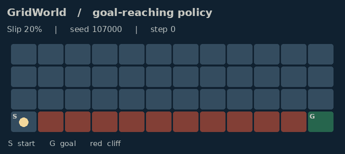
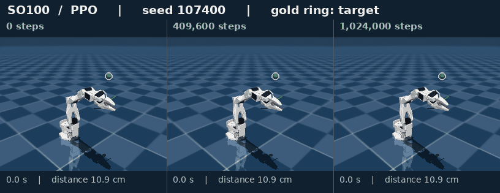
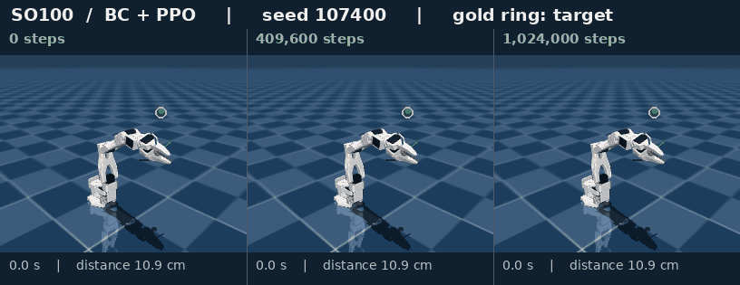
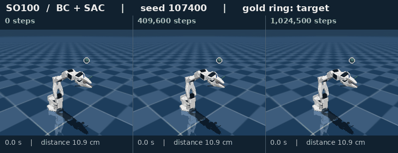

# HW4 · GridWorld에서 SO100 로봇팔까지

GridWorld에서는 상태 전이 확률로 행동을 고르고, CartPole에서는 경험으로 이산 행동의 가치를 학습합니다. 로봇팔 과제에서는 PPO와 SAC가 여섯 관절에 보낼 연속 제어 명령을 학습합니다.

<a id="ex1"></a>

## Ex1 · GridWorld

같은 칸에서 같은 행동을 해도 미끄러지면 다른 칸에 도착합니다. L04의 Bellman 계산은 가능한 전이를 모두 고려해 행동 가치를 구합니다.

`action_values`는 `env.P[state][action]`에 들어 있는 가능한 다음 칸들을 순회합니다. 각 전이가 행동 가치에 더하는 양은 다음 식입니다.

$$
p\,[r+\gamma(1-d)V(s')]
$$

`prob * (reward + gamma * values[nxt] * (not done))`에서 `prob`가 전이 확률 $p$, `values[nxt]`가 다음 칸의 가치 $V(s')$입니다. 절벽이나 목표에 닿아 종료되면 `not done`이 0이 되어 그 전이에서는 즉시 reward만 반영합니다.

**Policy iteration**은 `self.pi[s] @ action_values(...)`로 행동 가치에 현재 policy의 선택 확률을 곱해 평균을 냅니다. 상태 가치가 수렴하면 각 칸에서 가치가 가장 큰 행동을 고르고, 동률이면 그 행동들에 같은 확률을 배분합니다.

**Value iteration**은 매 갱신에서 `action_values(...).max()`를 택합니다. 각 칸에서 가장 좋은 행동의 가치를 곧바로 새 상태 가치로 쓰고, 값이 수렴한 뒤 policy를 구합니다.

두 구현 모두 입력 100개에서 정확성 검사를 통과했습니다. 별도 실험에서는 100스텝 안에 목표에 닿을 확률을 최대화하는 policy를 구했습니다. 미끄러짐 확률이 0.2일 때 그 이론적 상한은 **90.0017%**이며, 고정 시드 100회에서 91회 도달했습니다.

<details>
<summary>GridWorld에서 한 경로 따라가기</summary>

미끄러질 확률이 0.2인 격자에서 100스텝 안에 목표에 닿을 확률을 최대화하는 policy를 실행했습니다. 점은 시드 107000에서 실제로 방문한 칸을 따라갑니다.



</details>

<a id="ex2"></a>

## Ex2 · CartPole에서 DQN

CartPole에서는 관측을 `QNet`에 넣으면 카트를 왼쪽 또는 오른쪽으로 밀었을 때의 기대 누적 reward가 각각 나옵니다. L04의 DQN(Deep Q-Network)은 replay buffer에 저장한 경험 $(s,a,r,s',d)$로 Q값을 학습합니다.

목표값 $y$는 즉시 받은 reward $r$에 다음 상태에서 가장 큰 행동 가치의 할인값을 더한 값입니다. $\gamma$는 할인율이고, $d$는 buffer에 저장한 종료 표시입니다.

$$
y=r+\gamma(1-d)\max_{a'}Q_{\mathrm{target}}(s',a')
$$

`DQN.update`는 목표 네트워크의 출력에서 행동 축의 최댓값을 구합니다. 식에서 $d=1$이면 두 번째 항이 사라져 목표값은 $r$입니다.

```python
with torch.no_grad():
    future = self.target_q_net(tensor("next_states")).amax(dim=1)
    expected = tensor("rewards").reshape(-1) + self.gamma * future * (
        1 - tensor("dones").reshape(-1)
    )
```

현재 네트워크는 왼쪽과 오른쪽 행동의 Q값을 모두 출력합니다. `gather(1, actions)`로 실제로 실행한 행동의 값 `estimates`만 꺼내고, `F.mse_loss(estimates, expected)`를 줄입니다. `no_grad()` 안에서 구한 목표값은 이 역전파에서 고정되며, 목표 네트워크의 가중치는 지정한 간격에 현재 네트워크에서 복사합니다.

저장된 policy는 100개 에피소드 중 **99개**에서 누적 reward 475 이상을 기록했습니다.

<details>
<summary>DQN 추가 학습 전·중·후의 균형 잡기</summary>

기존 DQN에서 시작한 추가 학습을 같은 시드로 재현했습니다. 같은 초기 상태(시드 107100)에서 균형을 유지한 시간은 추가 학습 전 286스텝, 36 episode 후 452스텝, 72 episode 후 500스텝입니다. 각 패널은 그 시행이 끝난 자세에서 멈춥니다.


</details>

<a id="ex3"></a>

## Ex3 · PPO로 로봇팔 제어

PPO는 현재 policy로 모은 행동이 그 상태에서 기대한 것보다 얼마나 나았는지 나타내는 *advantage*를 사용합니다. `select_action`은 뽑은 행동의 로그 확률밀도와 critic의 상태 가치를 함께 반환합니다.

학습 루프는 각 스텝의 reward와 상태 가치를 rollout buffer에 저장합니다. ETH 배포 코드의 `compute_returns`는 궤적을 끝에서부터 거슬러 올라가며 ‘받은 reward + 할인된 다음 상태 가치 − 현재 상태 가치’를 계산합니다. 이 오차에 다음 스텝의 advantage를 $\gamma\lambda$만큼 반영해 현재 스텝의 advantage를 구합니다. 에피소드가 끝나는 경계에서는 누적을 끊습니다.

`compute_surrogate_loss`에서 $A$는 `adv_batch`이고, $\rho=\pi_{\rm new}(a\mid s)/\pi_{\rm old}(a\mid s)$는 같은 행동을 새 policy가 선택할 확률밀도와 이전 policy가 선택할 확률밀도의 비율입니다. 로그 확률밀도의 차이에 지수함수를 적용해 $\rho$를 구합니다.

```python
ratio = torch.exp(logp_batch - old_logp_batch)
clipped_ratio = torch.clamp(ratio, 1.0 - self.clip_ratio, 1.0 + self.clip_ratio)
surrogate_loss = -torch.minimum(
    ratio * adv_batch, clipped_ratio * adv_batch
).mean()
```

`self.clip_ratio`가 허용 폭 $\epsilon$입니다. 원래 비율과 제한한 비율에 각각 $A$를 곱해 작은 쪽을 고른 뒤, 평균에 음수를 붙입니다. 함수는 여기에 `surrogate_loss_coeff`를 곱한 값을 반환합니다.

예를 들어 $A=2$, $\epsilon=0.2$, $\rho=1.4$라면 두 항은 2.8과 2.4입니다. 이 표본에서 좋은 행동의 확률을 더 높여도 목적함수에 반영되는 이득은 2.4에서 멈춥니다.

시드 42로 1,024,000 환경 스텝 동안 학습했습니다.

<a id="demo"></a>

### PPO 학습 단계별 로봇팔 움직임

고정 평가의 첫 장면(시드 107400)을 사용했습니다. 세 패널은 같은 시작 자세에서 노란 원으로 표시한 목표를 3초간 추종합니다. 왼쪽부터 0, 409,600, 1,024,000 환경 스텝에서 저장한 모델입니다. 아래 숫자는 해당 순간의 손끝 오차입니다.



<details>
<summary>같은 장면에서 BC + PPO 보기</summary>

시연으로 행동을 먼저 학습한 뒤, 같은 세 시점에서 PPO를 비교했습니다. 왼쪽 패널은 BC를 마치고 PPO를 시작하는 시점입니다.



</details>

<a id="ex4"></a>

## Ex4 · SAC로 같은 로봇팔 제어

SAC(Soft Actor-Critic)는 replay buffer에 저장한 전이를 재사용합니다. L05의 maximum-entropy 목표는 기대 누적 reward와 행동 분포의 entropy를 함께 높이는 것입니다. `compute_critic_loss`는 다음 상태 $s'$에서 현재 actor로 행동 $a'$를 새로 뽑고 두 target critic의 추정치 중 작은 값으로 다음 목표를 계산합니다.

$$
y=r+\gamma(1-d)\left[\min_{i=1,2}Q_{\mathrm{target},i}(s',a')-\alpha\log\pi(a'\mid s')\right]
$$

`compute_critic_loss`에서 actor는 다음 상태의 행동 `next_action`과 그 행동의 로그 확률밀도 `next_logp`를 함께 반환합니다.

```python
next_action, next_logp = self.actor.act(next_obs)
q1_next, q2_next = self.critic_target(next_obs, next_action)
q_next = torch.minimum(q1_next, q2_next) - self.alpha * next_logp
target_q = rew + self.gamma * (1.0 - done) * q_next
```

`minimum`으로 두 target critic이 예측한 Q값 중 작은 쪽을 택하고, $-\alpha\log\pi$ 항을 더한 결과가 `q_next`입니다. 현재의 두 critic은 buffer에서 읽은 상태와 행동으로 각각 Q값을 예측하고, 두 예측의 `target_q`에 대한 평균 제곱 오차를 줄입니다. `train_sac.py`는 `done=terminal`을 저장하므로 시간 제한으로만 끝났다면 $d=0$이고 목표값에 다음 상태의 가치가 남습니다.

actor를 학습할 때는 현재 상태에서 행동을 다시 뽑습니다. `compute_actor_loss`는 두 critic의 추정치 중 작은 값 `q_new`를 사용해 `(self.alpha.detach() * logp_new - q_new).mean()`을 최소화합니다. Q값이 큰 행동을 선호하되 $\alpha$로 행동 분포의 entropy에 주는 비중을 조절합니다.

`compute_alpha_loss`로 목표 entropy에 맞춰 이 값을 조정하고, `soft_update_targets`로 현재 critic의 가중치를 target critic에 조금씩 반영합니다.

PPO와 같은 시드 42로 1,024,500 환경 스텝 동안 학습했습니다. PPO와 SAC의 총 환경 스텝 수는 과제 기본값과 같습니다. SAC는 128스텝마다 크기 256의 배치로 48회 업데이트했습니다.

### SAC 학습 단계별 로봇팔 움직임

PPO와 같은 장면에서 0, 409,600, 1,024,500 환경 스텝의 SAC 모델을 재생했습니다.


<details>
<summary>같은 장면에서 BC + SAC 보기</summary>

왼쪽은 BC를 마친 모델이고, 가운데와 오른쪽은 SAC로 추가 학습한 모델입니다.



</details>

## 로봇팔의 성공 기준

3초 동안 0.1초마다 측정한 **말단 위치 오차 30개의 평균이 5cm 미만**이면 해당 장면을 성공으로 집계했습니다. 고정 평가는 시드 107400~107499를 사용합니다. 보충 평가에서는 팔을 최대로 뻗어도 목표의 5cm 안에 닿지 않는 세 장면(107405·107410·107423)을 다음 세 시드(107500~107502)의 장면으로 교체했습니다.

순수 PPO와 순수 SAC는 무작위 가중치에서 학습을 시작했습니다. BC + PPO와 BC + SAC는 역기구학 시연 2,048개로 평균 행동을 먼저 학습했습니다. 네 policy 모두 GPU에서 학습한 뒤 CPU에서 평가했습니다.

| 최종 policy | 고정 100개 | 보충 100개 | 시드 107492의 3초 평균 오차 |
|---|---:|---:|---:|
| 순수 PPO | 95회 | **98회** | 5.765cm |
| BC + PPO | 93회 | **96회** | 6.298cm |
| 순수 SAC | 92회 | **95회** | 9.037cm |
| BC + SAC | 92회 | **95회** | 9.659cm |

이전 다단계 혼합 학습에서는 PPO와 SAC 모두 보충 100개 장면 중 98개에서 성공했습니다.

<a id="저장된-정책-재평가"></a>

## 저장된 policy 재평가

```bash
cd "$R"
python -m pytest -q tests/test_hw4.py
python experiments/hw4/cartpole.py
python experiments/hw4/evaluate.py "$PUB/implementations/hw4/results"
```

CartPole은 `99/100`을 출력합니다. 로봇팔 평가는 policy마다 103개 장면을 재현합니다. 각 장면의 초기 관측과 목표가 저장값과 같고, 평균 오차와 마지막 시점의 오차가 각각 저장값과 0.000001m 이내로 일치하면 통과합니다.

## GPU 학습 조건 재사용

`train_gpu.py`는 PyTorch 2.11.0+cu128에서 실행합니다. 새 실험 폴더에서 `python "$R/experiments/hw4/train_gpu.py" ppo rl`처럼 알고리즘(`ppo`, `sac`)과 초기화(`rl`, `bc`)를 선택합니다. BC 조건은 같은 폴더에서 먼저 `python "$R/experiments/hw4/generate_demos.py"`를 실행해 시연을 생성합니다.

[공식 과제](../../original/hw4/) · [실행 환경](../../#풀이-실행하기) · [실험 결과](results/)
